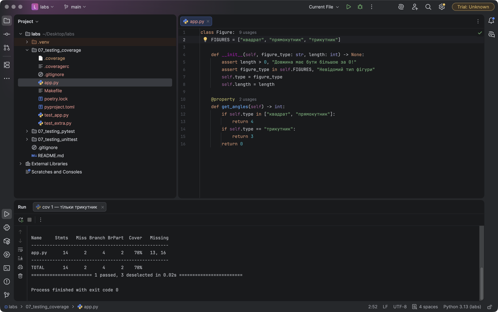
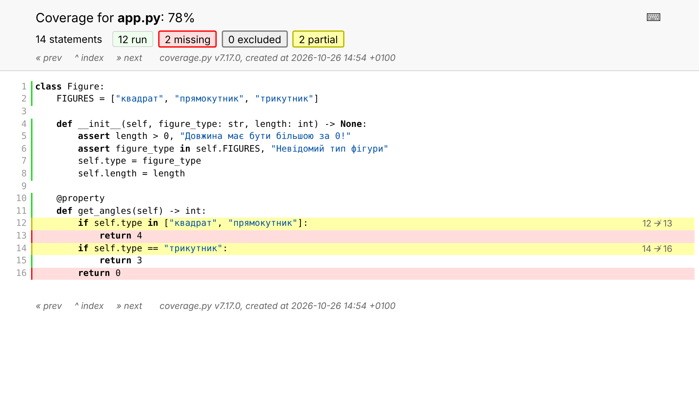
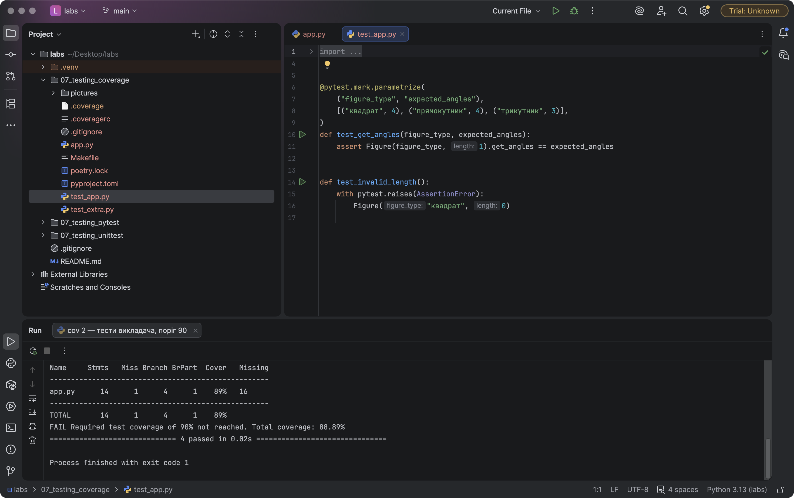
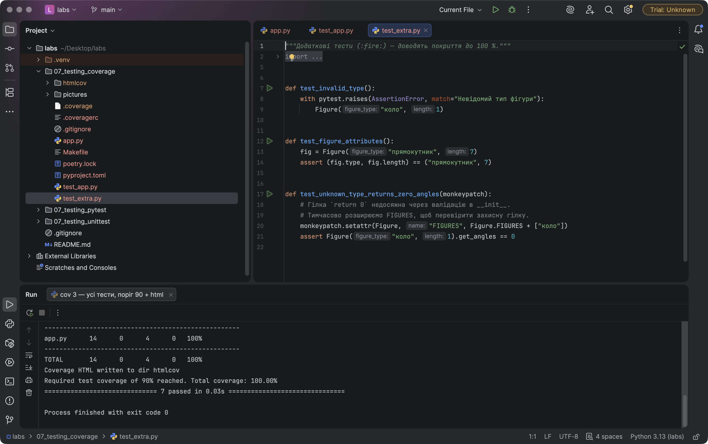
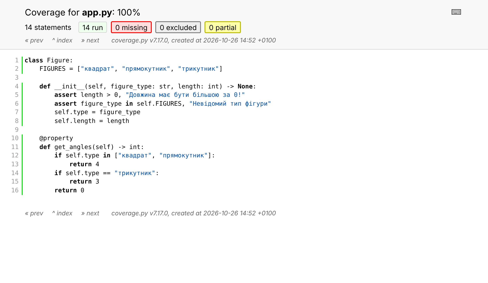
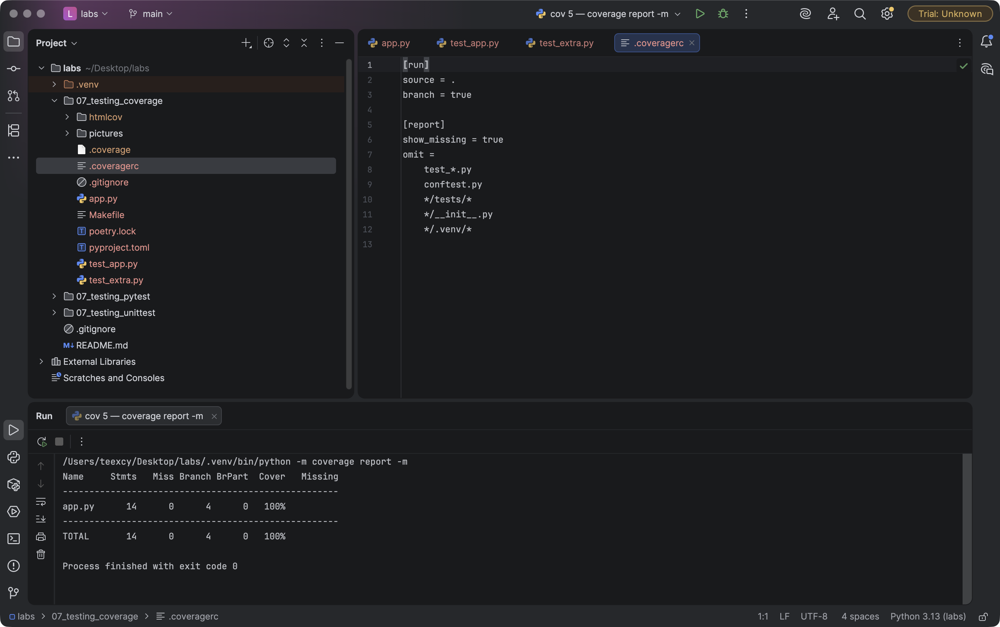
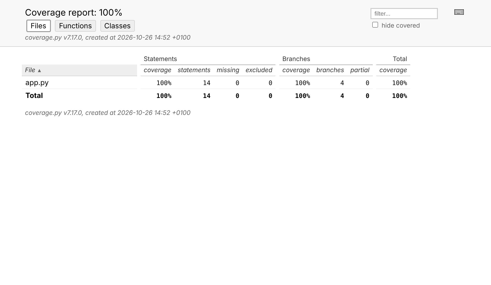

# Звіт до роботи
## Тема: Покриття коду (`coverage.py`, `pytest-cov`)
### Мета роботи: навчитися вимірювати покриття коду тестами (рядки та розгалуження), налаштовувати `coverage.py` через `.coveragerc`, будувати консольний і HTML-звіт, встановлювати мінімальний поріг покриття та доповнювати тести за результатами аналізу.

**Виконав:** Кушнір Андрій, група КН-41

---
### Структура роботи
| Файл | Призначення |
|------|-------------|
| [`app.py`](./app.py) | клас `Figure` з прикладу викладача (без змін) |
| [`test_app.py`](./test_app.py) | тести з прикладу: параметризований `get_angles` + некоректна довжина |
| [`test_extra.py`](./test_extra.py) | :fire: мої додаткові тести, що доводять покриття до 100 % |
| [`.coveragerc`](./.coveragerc) | налаштування `coverage.py` (`source`, `branch`, `omit`, `show_missing`) |
| [`pyproject.toml`](./pyproject.toml) / `poetry.lock` | Poetry-проєкт: `pytest`, `pytest-cov`, `coverage` у групі `dev` |
| [`Makefile`](./Makefile) | `make before`, `make cov`, `make html`, `make gate` |
| [`.gitignore`](./.gitignore) | `__pycache__/`, `.coverage`, `htmlcov/`, `.pytest_cache/` не комітяться |

### Встановлення
```bash
poetry add --group dev pytest pytest-cov coverage
poetry install
# або без Poetry:
pip install coverage pytest pytest-cov
```

### Команди запуску
> Скріншоти 01–04 зроблено в **PyCharm**: для кожної команди створено конфігурацію запуску з інтерпретатором `.venv` проєкту.

```bash
cd 07_testing_coverage
pytest -v                                                             # звичайний запуск тестів
pytest test_app.py -k трикутник --cov=app --cov-report=term-missing   # «до»: лише трикутник
pytest test_app.py --cov=app --cov-report=term-missing --cov-fail-under=90   # тести викладача + поріг
pytest --cov=app --cov-report=term-missing --cov-report=html --cov-fail-under=90  # усі тести + HTML
coverage run -m pytest      # збір даних через coverage.py
coverage report -m          # консольний звіт з непокритими рядками
coverage html               # HTML-звіт у htmlcov/
```

---
### Виконання роботи

#### 1. Покриття «до»: протестовано лише трикутник
Запуск лише одного параметризованого кейсу `test_get_angles[трикутник-3]`:

```text
Name     Stmts   Miss Branch BrPart  Cover   Missing
----------------------------------------------------
app.py      14      2      4      2    78%   13, 16
----------------------------------------------------
TOTAL       14      2      4      2    78%
1 passed, 3 deselected
```


**Які рядки пропущені й чому** (:star:):
- **рядок 13** `return 4` — умова `if self.type in ["квадрат", "прямокутник"]` для трикутника завжди хибна, тому гілку для квадрата/прямокутника не виконано жодного разу;
- **рядок 16** `return 0` — для трикутника функція повертає `3` у рядку 15 і до кінця не доходить;
- `BrPart = 2` — дві умови (рядки 12 і 14) виконались лише в один бік: `12 → 13` і `14 → 16` не пройдені.

HTML-звіт для цього стану (червоне — не виконано, жовте — частково покриті розгалуження):



#### 2. Тести для квадрата, прямокутника і трикутника (:star:)
Тест з прикладу параметризований для всіх трьох фігур:
```python
@pytest.mark.parametrize(
    ("figure_type", "expected_angles"),
    [("квадрат", 4), ("прямокутник", 4), ("трикутник", 3)],
)
def test_get_angles(figure_type, expected_angles):
    assert Figure(figure_type, 1).get_angles == expected_angles
```
Після запуску всіх тестів з `test_app.py` рядок 13 покрито, покриття зросло **78 % → 89 %**. Але:

```text
Name     Stmts   Miss Branch BrPart  Cover   Missing
----------------------------------------------------
app.py      14      1      4      1    89%   16
----------------------------------------------------
TOTAL       14      1      4      1    89%
FAIL Required test coverage of 90% not reached. Total coverage: 88.89%
```


Тобто **з тестами самого прикладу поріг `--cov-fail-under=90` не проходить** (процес завершується з кодом 1). Причина — рядок 16 `return 0`.

#### 3. :fire: Поріг покриття і доповнення тестів
**Чому `return 0` не покривається звичайними тестами:** `__init__` перевіряє `assert figure_type in self.FIGURES`, тому об'єкт з «невідомим» типом створити неможливо — гілка є захисною (defensive) і через публічний інтерфейс недосяжна.

Варіанти: прибрати мертвий код, позначити його `# pragma: no cover` або **перевірити поведінку штучно**. Я обрав третій — це не приховує рядок від звіту, а реально перевіряє, що функція повертає `0` для невідомої фігури. Для цього `monkeypatch` тимчасово розширює `Figure.FIGURES` лише в межах одного тесту:

```python
def test_unknown_type_returns_zero_angles(monkeypatch):
    monkeypatch.setattr(Figure, "FIGURES", Figure.FIGURES + ["коло"])
    assert Figure("коло", 1).get_angles == 0
```
Також додано тести на невідомий тип у конструкторі та на атрибути об'єкта ([`test_extra.py`](./test_extra.py)).

Результат з порогом 90 %:
```text
Name     Stmts   Miss Branch BrPart  Cover   Missing
----------------------------------------------------
app.py      14      0      4      0   100%
----------------------------------------------------
TOTAL       14      0      4      0   100%
Coverage HTML written to dir htmlcov
Required test coverage of 90% reached. Total coverage: 100.00%
7 passed
```




#### 4. `coverage run` / `coverage report -m` і `.coveragerc`
Той самий результат через сам `coverage.py`; налаштування беруться з `.coveragerc`, тому в командному рядку нічого додатково передавати не потрібно:

```ini
[run]
source = .
branch = true

[report]
show_missing = true
omit =
    test_*.py
    conftest.py
    */tests/*
    */__init__.py
    */.venv/*
```
- `[run] source = .` — аналізувати Python-файли поточної папки;
- `branch = true` — рахувати не лише рядки, а й переходи між гілками `if`;
- `[report] omit` — не включати до звіту самі тести та службові файли; `show_missing` — завжди показувати колонку `Missing`.



Головна сторінка HTML-звіту (`htmlcov/index.html`):



> Скріншоти 05–07 — HTML-звіти `coverage html`, відкриті в браузері. Сама папка `htmlcov/` (як і `.coverage`) додана до `.gitignore` і в репозиторій не комітиться.

#### 5. Порівняння покриття до і після
| Стан | Тести | Рядки (Stmts/Miss) | Гілки (Branch/BrPart) | Cover | Поріг 90 % |
|------|-------|--------------------|-----------------------|-------|-----------|
| До | лише трикутник | 14 / 2 | 4 / 2 | **78 %** | ✗ |
| Тести прикладу | 3 фігури + некоректна довжина | 14 / 1 | 4 / 1 | **89 %** | ✗ |
| Після | + `test_extra.py` | 14 / 0 | 4 / 0 | **100 %** | ✓ |

#### 6. Різниця між покриттям рядків і покриттям розгалужень
- **Покриття рядків (line/statement coverage)** відповідає на питання «чи виконувався цей рядок хоча б раз». Рядок з `if` вважається покритим, щойно умову перевірили — незалежно від того, якою вона виявилась.
- **Покриття розгалужень (branch coverage)** перевіряє, чи пройдено **кожен можливий перехід**: для `if` — і випадок `True`, і випадок `False`. `coverage.py` позначає такі рядки як *partial* (`BrPart`), а в HTML показує стрілку непройденого переходу (`12 → 13`, `14 → 16`).

На прикладі стану «до»:
- лише рядки: `(14 − 2) / 14 = 85.7 %` — виглядає непогано;
- рядки + гілки (як рахує `coverage` з `branch = true`): `(14 − 2 + 4 − 2) / (14 + 4) = 14 / 18 = 77.8 %`.

Тобто branch coverage суворіший: він показує, що умови в рядках 12 і 14 перевірено лише в один бік, навіть коли самі рядки «зелені». Водночас навіть 100 % покриття не доводить якість тестів — воно лише гарантує, що кожен рядок і перехід було виконано, а не те, що результат перевірено правильними `assert`.

---
### Доповнення за актуальною умовою (07.11.2026)

Попередні скріншоти вище показують початкову версію роботи з 7 pytest-тестами.
Після додавання `test_unittest.py` повний запуск містить **13 тестів**.
Нижче наведено повторні вимірювання; повні команди та фактичний вивід збережені в [`results/`](./results/).

#### Окремі запуски unittest та pytest

`test_unittest.py` взято з [актуального прикладу викладача](https://github.com/BobasB/it_college/blob/main/example/testing/03_coverage/test_unittest.py).

```bash
python -m coverage erase
python -m coverage run -m unittest discover
python -m coverage report -m

python -m coverage erase
python -m coverage run -m pytest
python -m coverage report -m
```

| Запуск | Результат | Покриття app.py | Непокриті рядки |
| --- | --- | --- | --- |
| unittest discover | 6 тестів, OK | 100%, 14 операторів / 4 гілки | немає |
| pytest | 13 passed, включно з 6 unittest-тестами | 100%, 14 операторів / 4 гілки | немає |

Результати: [`03_unittest.txt`](./results/03_unittest.txt), [`04_pytest.txt`](./results/04_pytest.txt).
`coverage erase` очищає дані перед кожним окремим вимірюванням.
Без режиму додавання `coverage run` зазвичай перезаписує дані; накопичення
потребує `--append` або відповідного налаштування. Очищення робить намір явним.

#### Межі аналізу та pragma: no cover

У головному `.coveragerc` залишено `source = .`: `app.py` присутній у звіті,
а `test_*.py`, середовища та окремі навчальні приклади `*/examples/*` виключено
з підсумкової таблиці. Це підтверджує [`08_final.txt`](./results/08_final.txt):
у таблиці є лише `app.py`. Приклади запускаються окремими командами;
`norecursedirs` запобігає випадковому включенню демонстрацій у звичайний pytest.

У `app.py` немає точки входу скрипта. Його логіку не змінено і не виключено.
Для демонстрації створено [`examples/entry_point.py`](./examples/entry_point.py):

```python
if __name__ == "__main__":  # pragma: no cover
    print(main())
```

Тест [`test_entry_point.py`](./examples/test_entry_point.py) перевіряє `main()`
і очікувані 3 кути. Виключено лише оболонку запуску і друк; сама функція
та логіка `Figure` залишаються предметом перевірок.
Це доречно для прикладу, у якому консольний вивід не є тестованим контрактом.
Якби точний вивід був вимогою програми, слід було б тестувати і його.

Порівняння виконано в ізольованій тимчасовій папці: скопійовано `app.py`,
`entry_point.py` та `test_entry_point.py`, запущено наведені нижче команди
спочатку без позначки, потім з нею. Окрема папка не успадковує головний `.coveragerc`.

```bash
python -m coverage erase
python -m coverage run --branch --source=entry_point -m pytest test_entry_point.py
python -m coverage report -m
```

| entry_point.py | Stmts | Miss | Branch | BrPart | Cover | Missing |
| --- | --- | --- | --- | --- | --- | --- |
| Без pragma | 5 | 1 | 2 | 1 | 71% | 10 |
| З pragma | 3 | 0 | 0 | 0 | 100% | немає |

Повний вивід: [`07_pragma_comparison.txt`](./results/07_pragma_comparison.txt).
Змінився знаменник вимірювання, а не кількість виконаних перевірок бізнес-логіки.
Гілку `return 0` у `app.py` не приховано: її реально перевіряють тести.

#### Тест без assert та з assert

```bash
python -m pytest examples/test_call_only.py --cov=app --cov-report=term-missing
python -m pytest examples/test_with_assert.py --cov=app --cov-report=term-missing
```

Обидва окремі запуски: **1 passed**, покриття **78%**, пропущені рядки **13, 16**,
частково покриті 2 переходи. Результати:
[`05_call_only.txt`](./results/05_call_only.txt), [`06_with_assert.txt`](./results/06_with_assert.txt).

Перший тест лише виконує `Figure("трикутник", 1).get_angles`: неправильне число
кутів не спричинить падіння. Другий перевіряє `assert ... == 3`, тому помилкове
повернення 4 вже буде виявлено. Coverage однаковий, гарантії тестів різні.
Навіть 100% покриття не гарантує перевірки всіх вхідних даних, правильності
очікуваних значень або відсутності помилок у вимогах.

#### HTML, XML та CI

```bash
python -m pytest --cov=app --cov-branch --cov-report=term-missing --cov-report=html --cov-report=xml --cov-fail-under=90
```

Результат: **13 passed**, **100%**, поріг 90% пройдено, непокритих рядків немає.
Підтвердження: [`08_final.txt`](./results/08_final.txt).
HTML у `htmlcov/index.html` призначено для перегляду людиною: підсвічування
рядків і непокритих переходів. XML призначено для CI та автоматичних аналізаторів.
Файл `coverage.xml` генерується локально; його зафіксована копія для звіту —
[`results/coverage-report.xml`](./results/coverage-report.xml).
Службові `.coverage`, `htmlcov/`, `.pytest_cache/` та кореневий `coverage.xml`
залишаються в `.gitignore`.

Додано [GitHub Actions workflow](../.github/workflows/coverage.yml): Python 3.13,
зафіксовані версії залежностей, поріг 90%, HTML/XML як артефакти.
Початковий набір `test_app.py` дає 88,89% і код виходу 1
([`02_threshold_failure.txt`](./results/02_threshold_failure.txt));
повний набір дає 100% і код 0. CI використовує той самий механізм порога.
Статус віддаленого запуску потрібно перевірити у вкладці Actions після публікації;
локальний успіх сам по собі не підтверджує виконання GitHub Actions.

#### Матеріали репозиторію групи

07.11.2026 перевірено доступні у викладача
[2026_kn230_oop](https://github.com/BobasB/2026_kn230_oop),
[2026_kn31_oop](https://github.com/BobasB/2026_kn31_oop) та
[2026_kn32_oop](https://github.com/BobasB/2026_kn32_oop).
У них на момент перевірки є вступні матеріали й перші лабораторні з ООП,
окремих матеріалів про testing/coverage не знайдено.
У локальному звіті вказано КН-41; відповідність конкретному репозиторію
`2026_kn**` потребує уточнення. Тому виконання додаткових завдань саме
своєї групи не заявляється. Основою цієї роботи є загальні матеріали coverage
та актуальний приклад викладача.

---
### Висновок:
- **Що зроблено:** налаштовано Poetry-проєкт з `pytest`, `pytest-cov`, `coverage`; створено `.coveragerc`; виміряно покриття для трьох станів тестів (78 % → 89 % → 100 %); побудовано консольний і HTML-звіти; встановлено поріг `--cov-fail-under=90` і доповнено тести так, щоб він проходив.
- **Чи досягнуто мети:** так, завдання з coverage виконано локально; віддалений CI та матеріали конкретної групи потребують окремого підтвердження.
- **Нові знання:** різниця між покриттям рядків і розгалужень та як `coverage` рахує відсоток з `branch = true`; що поріг покриття можна використати як «ворота» якості (ненульовий код виходу ламає CI); що недосяжний захисний код потребує окремого рішення — видалення, `pragma: no cover` або штучної перевірки через `monkeypatch`.
- **Чи вдалось відповісти на всі питання:** питання з coverage розглянуто; репозиторій конкретної групи ще потрібно уточнити.
- **Складності:** тести самого прикладу дають 88.89 % і не проходять поріг 90 % через недосяжну гілку `return 0` — довелося розібратися, чому її не можна покрити звичайним способом. Також у PyCharm звичайний test runner запускає pytest з `--no-summary`, через що таблиця покриття не виводилась; вирішено запуском `pytest` як модуля (`python -m pytest`).
- **Feedback:** робота наочна — HTML-звіт одразу показує, які гілки не перевірені.
- **Suggestions:** використовувати доданий workflow GitHub Actions для автоматичної перевірки порога покриття.

---
