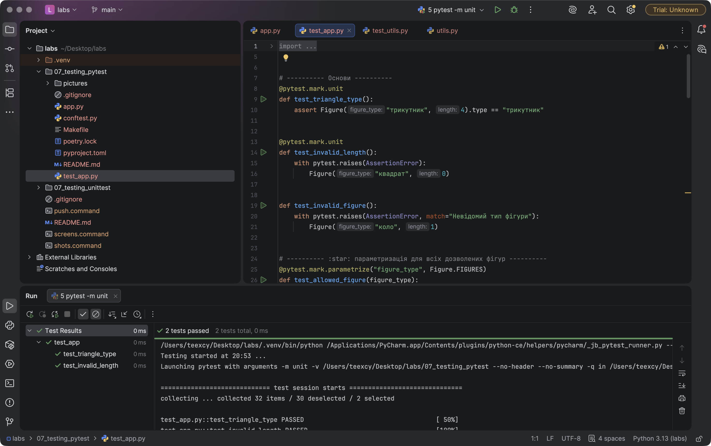
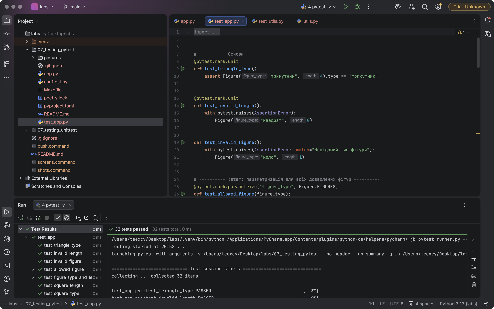
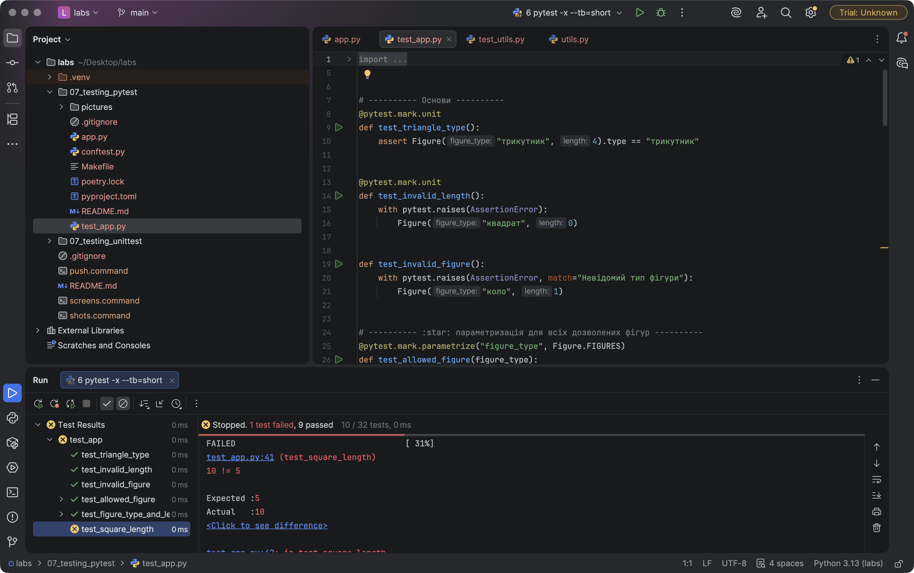

# Звіт до роботи
## Тема: Тестування з бібліотекою `pytest`
### Мета роботи: навчитися писати тести у вигляді функцій `pytest`, використовувати `assert` і `pytest.raises`, параметризацію, fixtures (зокрема `scope`, `yield`, `conftest.py`, вбудовані `tmp_path`/`monkeypatch`/`capsys`) та маркери; організувати тести в Poetry-проєкті.

**Виконав:** Кушнір Андрій, група КН-41

---
### Структура роботи
| Файл | Призначення |
|------|-------------|
| [`app.py`](./app.py) | клас `Figure` з прикладу + `print_info()` для перевірки виводу |
| [`conftest.py`](./conftest.py) | спільні fixtures: `length`, `square`, `allowed_figures` (`scope="module"`) |
| [`test_app.py`](./test_app.py) | 32 тести (з урахуванням параметризації) |
| [`pyproject.toml`](./pyproject.toml) / `poetry.lock` | Poetry-проєкт, `pytest` у групі `dev`, налаштування pytest і маркери |
| [`Makefile`](./Makefile) | короткі команди: `make test`, `make unit`, `make fail-fast` |

### Встановлення `pytest`
```bash
poetry init                       # створення проєкту (package-mode = false)
poetry add --group dev pytest     # pytest — лише залежність для розробки
poetry install
# альтернатива без Poetry:
pip install pytest
```
У `pyproject.toml` pytest потрапив саме в dev-групу:
```toml
[tool.poetry.group.dev.dependencies]
pytest = "^9.1.1"
```

### Команди запуску
> Скріншоти у звіті зроблено в **PyCharm**: для кожної команди створено конфігурацію запуску pytest з інтерпретатором `.venv` проєкту (аргументи `-v`, `-m unit -v`, `-x --tb=short`).

```bash
poetry run pytest -v                                   # усі тести
poetry run pytest test_app.py::test_triangle_type -v   # один тест
poetry run pytest -m unit -v                           # лише з маркером unit
poetry run pytest --collect-only -q                    # які тести знайдено
poetry run pytest -x --tb=short                        # стоп на першій помилці
make test   # те саме через Makefile
```

---
### Виконання роботи

#### 1. Основи
1. Тести — звичайні функції з префіксом `test_` у файлі `test_*.py`; pytest знаходить їх автоматично.
2. Для перевірки достатньо звичайного `assert` — pytest сам розкладає вираз і показує значення (див. п.5: `assert 10 == 5` / `where 10 = ...get_figure_length`).
3. Винятки — через `pytest.raises`, з параметром `match` можна перевірити й текст повідомлення:
    ```python
    def test_invalid_figure():
        with pytest.raises(AssertionError, match="Невідомий тип фігури"):
            Figure("коло", 1)
    ```

#### 2. Параметризація та fixtures
1. :star: **Параметризований тест для всіх дозволених фігур** — один тест виконується 3 рази, по разу на кожен тип:
    ```python
    @pytest.mark.parametrize("figure_type", Figure.FIGURES)
    def test_allowed_figure(figure_type):
        assert Figure(figure_type, 1).type == figure_type
    ```
    Додатково — параметризація кількома аргументами з власними `ids` (`square-min`, `rectangle-7`, `triangle-100`).
2. :star: **Fixture з довжиною 10.** Fixture `square` залежить від fixture `length`, обидві в `conftest.py`, тому імпортувати їх у тест не треба:
    ```python
    @pytest.fixture
    def length():
        return 10

    @pytest.fixture
    def square(length):
        return Figure("квадрат", length)

    def test_square_length(square):
        assert square.get_figure_length == 10
    ```
    Тест `test_fixture_reused_inside_one_test` перевіряє, що в межах одного тесту `length` створюється один раз: значення, отримане тестом, і значення всередині `square` — **той самий об'єкт** (`is`).
3. :fire: **Кожен неправильний тип і кожна неправильна довжина** — окремий тест на кожне значення:
    - типи: `"коло"`, `""`, `"Квадрат"` (регістр), `"квадрат "` (пробіл), `"ромб"`, `None`, `3` → `AssertionError`;
    - довжини: `0`, `-1`, `-100`, `-0.5` → `AssertionError` з текстом «Довжина має бути більшою за 0»;
    - нечислові довжини `"5"`, `None`, `[5]` → `TypeError` (Python 3 не порівнює їх з `0`, тому падає ще до `assert`).
4. **Fixture з `yield` і `tmp_path`** — створює файл у тимчасовій папці тесту, а код після `yield` видаляє його навіть у разі помилки.
5. **`monkeypatch`** — тимчасово додає фігуру «ромб» до `Figure.FIGURES`; наступний тест `test_monkeypatch_restored` підтверджує, що після тесту атрибут повернуто.
6. **`capsys`** — перехоплює `print()` і перевіряє текст: `"трикутник: довжина 3\n"`.

#### 3. Розширені можливості
1. :star: **Маркер `unit`** додано до двох тестів (`test_triangle_type`, `test_invalid_length`) і зареєстровано в `pyproject.toml`, тому pytest не видає `PytestUnknownMarkWarning`:
    ```toml
    [tool.pytest.ini_options]
    markers = [
        "unit: швидкі юніт-тести",
        "slow: повільні тести",
    ]
    ```
    Запуск лише цих тестів — `2 passed, 30 deselected`:

    

2. :star: **Fixture зі `scope="module"`** використовується у двох тестах. Щоб довести, що вона створюється **один раз на модуль**, у `conftest.py` є лічильник викликів, і другий тест перевіряє, що він дорівнює `1`:
    ```python
    @pytest.fixture(scope="module")
    def allowed_figures():
        CALLS["allowed_figures"] += 1
        return tuple(Figure.FIGURES)
    ```
    Повертається `tuple`, а не список: спільний стан на рівні модуля має бути незмінним, інакше один тест міг би зіпсувати дані іншому.

3. **Кирилиця в назвах тестів.** За замовчуванням pytest показує id параметрів як `test_allowed_figure[кв...]`. Опція `disable_test_id_escaping_and_forfeit_all_rights_to_community_support = true` у `pyproject.toml` вимикає екранування, і назви стають читабельними: `test_allowed_figure[квадрат]`.

#### 4. Результат запуску з `-v`
```text
$ poetry run pytest -v
collected 32 items
test_app.py::test_triangle_type PASSED
test_app.py::test_allowed_figure[квадрат] PASSED
...
test_app.py::test_print_info PASSED
============================== 32 passed in 0.06s ==============================
```


#### 5. :fire: Навмисно зламаний тест + `pytest -x --tb=short`
Змінив очікування в `test_square_length` з `10` на `5`:



**Пояснення результату:**
- `test_app.py .........F` — 9 тестів пройшли, 10-й упав (у PyCharm: `Stopped. 1 test failed, 9 passed — 10/32 tests`);
- `-x` (exitfirst) зупинив запуск одразу після першої помилки: `stopping after 1 failures`, тому решта 22 тести **не виконувались** (`1 failed, 9 passed` замість 32). Це зручно в CI або при довгому наборі тестів — не треба чекати до кінця;
- `--tb=short` скоротив traceback до одного кадру: файл і рядок (`test_app.py:42`), сам вираз і пояснення від pytest — `assert 10 == 5`, `where 10 = <...>.get_figure_length`. Тобто видно (у PyCharm — `Expected :5`, `Actual :10`), що fixture дала 10, а тест очікував 5 — помилка в тесті, а не в класі;
- після повернення правильного значення: `32 passed`.

#### 6. Різниця між `unittest.TestCase` і функцією `pytest`
Той самий тест у двох стилях:
```python
# unittest
class TestFigure(unittest.TestCase):
    def setUp(self):
        self.obj = Figure("квадрат", 10)

    def test_length(self):
        self.assertEqual(10, self.obj.get_figure_length)

    def test_invalid(self):
        with self.assertRaises(AssertionError):
            Figure("коло", 1)

# pytest
def test_length(square):
    assert square.get_figure_length == 10

def test_invalid():
    with pytest.raises(AssertionError):
        Figure("коло", 1)
```

| | `unittest` | `pytest` |
|---|---|---|
| Де живе | стандартна бібліотека | стороння бібліотека (`dev`-залежність) |
| Форма тесту | метод класу-нащадка `TestCase` | звичайна функція `test_*` |
| Перевірки | `assertEqual`, `assertTrue`, `assertIn`… | звичайний `assert` з детальним розбором виразу |
| Підготовка даних | `setUp`/`tearDown`, `setUpClass` — одна на весь клас | fixtures: тест бере лише потрібні, вони комбінуються, мають `scope`, `yield`-очищення, `conftest.py` |
| Набори даних | цикл + `subTest` | `@pytest.mark.parametrize` — кожен набір окремий тест з власним id |
| Групування / вибір | за класом/модулем | маркери (`-m unit`), `-k`, `::назва` |
| Сумісність | — | pytest запускає і `unittest`-тести без змін |

---
### Висновок:
- **Що зроблено:** створено Poetry-проєкт з `pytest` у dev-групі, написано 32 тести: параметризація для всіх дозволених фігур, окремі тести для кожного неправильного типу й довжини, fixtures (залежні, `scope="module"`, `yield` + `tmp_path`), `monkeypatch`, `capsys`, маркер `unit`, спільні fixtures у `conftest.py`, `Makefile` для запуску.
- **Чи досягнуто мети:** так, усі завдання з :star: і :fire: виконано, усі тести проходять.
- **Нові знання:** fixtures гнучкіші за `setUp` — тест отримує лише те, що просить, а pytest сам будує граф залежностей і кешує результат у межах `scope`; параметризація дає окремий звіт по кожному набору даних; `-x --tb=short` пришвидшує пошук помилки.
- **Чи вдалось відповісти на всі питання:** так.
- **Складності:** кириличні id параметрів pytest за замовчуванням виводить у вигляді `\uXXXX` — вирішено опцією в `pyproject.toml`. Також помітив, що нечислова довжина дає `TypeError`, а не `AssertionError`, — це враховано окремим тестом.
- **Feedback:** pytest зручніший за `unittest` — менше шаблонного коду, а вивід помилок значно інформативніший.
- **Suggestions:** логічне продовження — запуск `make test` у GitHub Actions на кожен push.

---
