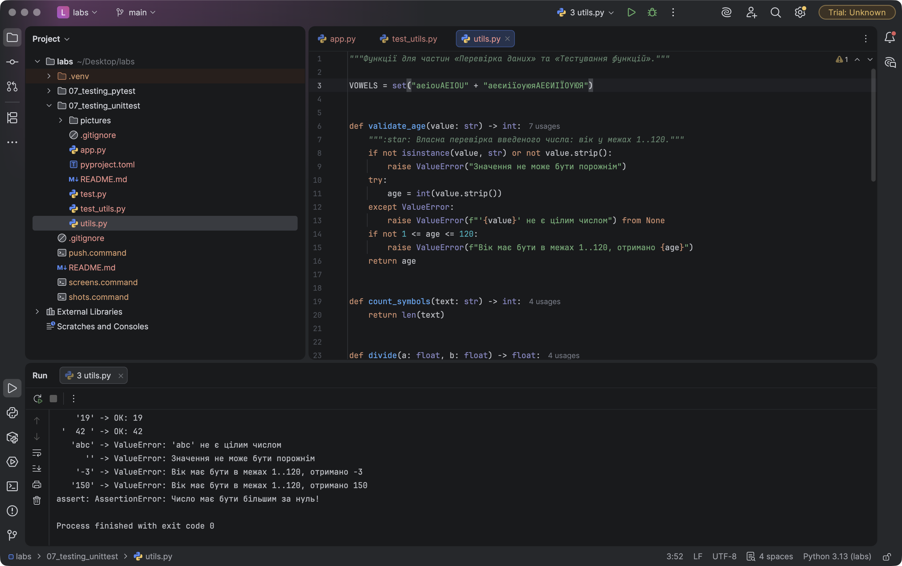
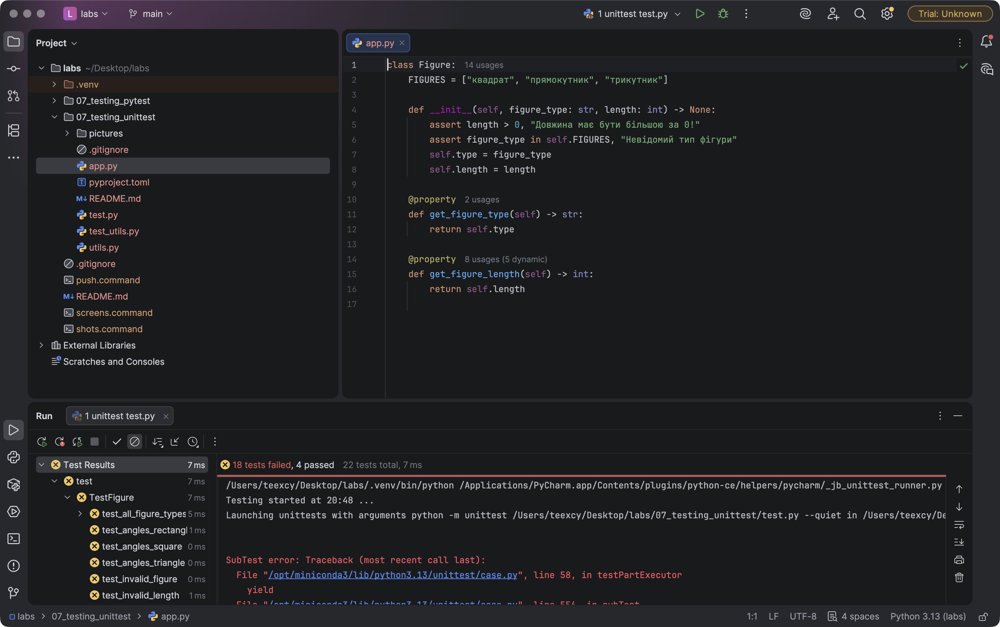
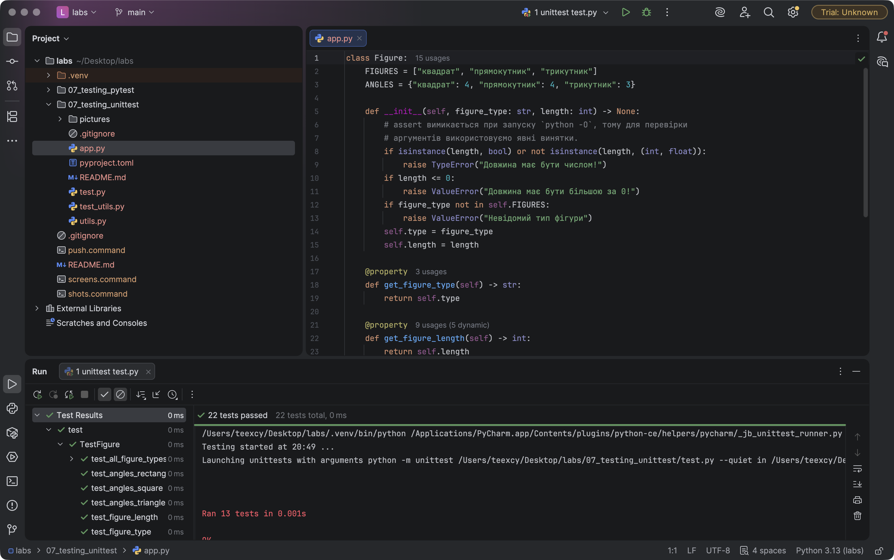
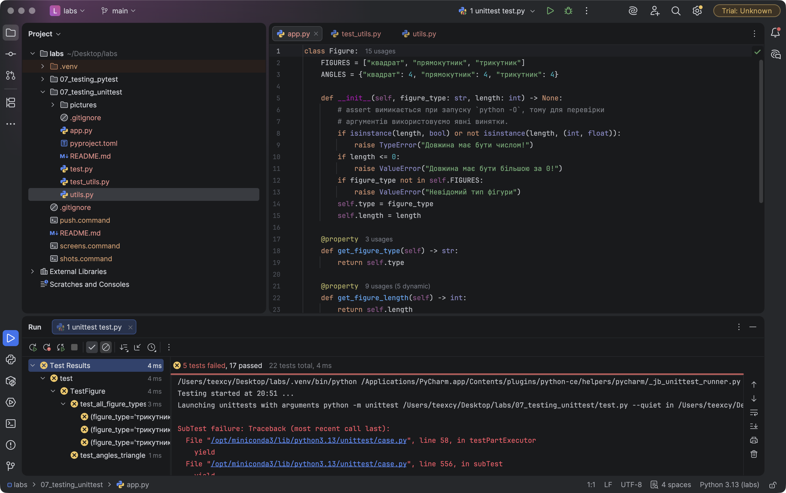
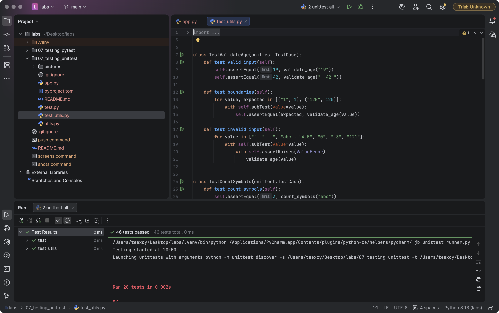

# Звіт до роботи
## Тема: Загальне тестування та юніт-тести (`unittest`)
### Мета роботи: навчитися перевіряти вхідні дані (`assert`, `raise`), писати юніт-тести з використанням `unittest.TestCase`, застосовувати життєвий цикл тесту (`setUp`/`tearDown`/`setUpClass`), `subTest` та `unittest.mock.patch`.

**Виконав:** Кушнір Андрій, група КН-41

---
### Структура роботи
| Файл | Призначення |
|------|-------------|
| [`app.py`](./app.py) | клас `Figure` (виправлений) + метод `get_angles` |
| [`test.py`](./test.py) | 13 тестів для `Figure` (+ `subTest` на 9 комбінацій) |
| [`utils.py`](./utils.py) | `validate_age`, `count_symbols`, `divide`, `count_vowels`, `ask_age` (з `input()`) |
| [`test_utils.py`](./test_utils.py) | 15 тестів для функцій, у т.ч. з `mock.patch` |
| [`pyproject.toml`](./pyproject.toml) | опис Poetry-проєкту (залежностей немає — лише стандартна бібліотека) |

### Команди запуску
> Скріншоти у звіті зроблено в **PyCharm**: для кожної команди нижче створено конфігурацію запуску з інтерпретатором `.venv` проєкту.

```bash
cd 07_testing_unittest
python app.py                 # ручна перевірка властивостей Figure
python utils.py               # перевірка введеного числа
python test.py                # тести Figure
python -m unittest -v         # автопошук і запуск усіх тестів (test*.py)
python -O test.py             # тести з вимкненими assert (див. п.3)
# або через Poetry
poetry install && poetry run python -m unittest -v
```

---
### Виконання роботи

#### 1. Перевірка даних
1. `assert` перевіряє твердження і зупиняє програму з `AssertionError`, якщо умова хибна.
2. `raise ValueError` використовується, коли треба явно повідомити про неправильний аргумент.
3. :star: Створив власну перевірку введеного числа — `validate_age()` у [`utils.py`](./utils.py): рядок → ціле число в межах 1..120, інакше `ValueError` з поясненням.



```text
    '19' -> OK: 19
 '  42 ' -> OK: 42                         <- пробіли обрізаються
   'abc' -> ValueError: 'abc' не є цілим числом
      '' -> ValueError: Значення не може бути порожнім
    '-3' -> ValueError: Вік має бути в межах 1..120, отримано -3
   '150' -> ValueError: Вік має бути в межах 1..120, отримано 150
assert: AssertionError: Число має бути більшим за нуль!
```
Правильне введення повертає `int`, неправильне — `ValueError` із текстом, який пояснює причину (порожнє / не число / поза межами).

#### 2. Тестування функцій
1. Для `count_symbols` визначив очікування для звичайних (`"abc"` → 3), порожніх (`""` → 0) і граничних (`" "` → 1) даних.
2. Для `divide` перевірив і нормальний результат, і помилку `ZeroDivisionError` через `assertRaises`.
3. :star: Функція `count_vowels()` рахує голосні латиниці та української абетки (`а е є и і ї о у ю я`). Тестів — 7 (вимога ≥ 3).
4. :fire: Окремі тести для порожнього рядка (`""` → 0), рядка з цифрами (`"1234567890"` → 0, `"a1b2e3"` → 2) та українських літер (`"Україна"` → 4, `"Їжак їсть яблуко"` → 6, `"ЄИІЮ"` → 4).

```python
def count_vowels(text: str) -> int:
    if not isinstance(text, str):
        raise TypeError("Очікується рядок")
    return sum(1 for ch in text if ch in VOWELS)
```

#### 3. Перший приклад (`Figure`) — тест, який спочатку не проходив
1. Створив кілька об'єктів `Figure` і перевірив властивості вручну (`python app.py`):
    ```text
    квадрат      довжина=5   кутів=4
    прямокутник  довжина=3   кутів=4
    трикутник    довжина=7   кутів=3
    ```
2. Ознайомився з `test.py`. У поточній версії прикладу тест довжини вже розкоментований і проходить, тому помилку шукав у **валідації** класу.
3. **Знайдена помилка:** `Figure.__init__` перевіряє аргументи через `assert`. При запуску інтерпретатора з прапорцем `-O` (оптимізація) усі `assert` видаляються, і клас приймає будь-які дані:
    ```text
    $ python -O -c "from app import Figure; f = Figure('коло', -3); print(f.get_figure_type, f.get_figure_length)"
    коло -3          <- некоректна фігура успішно створена!
    ```
4. Спочатку написав тести (підхід TDD): очікування `ValueError` для нульової/від'ємної довжини та невідомого типу, тести `get_angles` для квадрата, прямокутника і трикутника, `subTest` для всіх типів. На **оригінальному** `app.py` результат — `FAILED (failures=5, errors=12)` (PyCharm рахує кожен `subTest` окремо, тому показує `18 tests failed, 4 passed`):
    - `FAIL` — клас кидав `AssertionError` замість `ValueError`;
    - `ERROR` — методу `get_angles` ще не існувало (`AttributeError`).

    

5. **Виправлення** в [`app.py`](./app.py): `assert` замінено на явні `raise ValueError` / `TypeError`, додано `get_angles`:
    ```python
    if isinstance(length, bool) or not isinstance(length, (int, float)):
        raise TypeError("Довжина має бути числом!")
    if length <= 0:
        raise ValueError("Довжина має бути більшою за 0!")
    if figure_type not in self.FIGURES:
        raise ValueError("Невідомий тип фігури")
    ...
    @property
    def get_angles(self) -> int:
        return self.ANGLES[self.type]
    ```
6. Після виправлення всі 13 тестів проходять (у PyCharm — `22 tests passed` разом із subTest), у тому числі з `python -O test.py`:

    

7. :fire: Додані тести для нульової довжини, від'ємної довжини, невідомого типу фігури, а також нечислової довжини (`"5"` → `TypeError`) і мінімально допустимого значення (`1`).

#### 4. Життєвий цикл тесту
У `TestFigure` використано:
- `setUpClass` — один раз зберігає список допустимих типів фігур;
- `setUp` — перед кожним тестом створює свіжий об'єкт `Figure("квадрат", 5)`, тому тести незалежні;
- `tearDown` — після кожного тесту видаляє об'єкт;
- усі методи починаються з `test_`, інакше `unittest` їх не знайде.

#### 5. Розширені можливості `unittest`
1. :star: **`subTest`** — `test_all_figure_types` перевіряє 3 типи × 3 довжини = 9 комбінацій в одному тесті.

    **Призначення `subTest` у моєму прикладі:** без нього перша ж помилка зупинила б цикл, і було б невідомо, які ще комбінації зламані. Щоб це показати, я тимчасово «зламав» кількість кутів трикутника (4 замість 3). `subTest` продовжив виконання і показав **кожен** невдалий набір параметрів окремо (у дереві PyCharm — три рядки `figure_type='трикутник'`) — видно, що проблема лише в трикутнику і не залежить від довжини:

    

2. :star: **`mock.patch`** — функція `ask_age()` викликає `input()`. У тесті `input` підміняється, тому тест не чекає на клавіатуру і завжди дає однаковий результат:
    ```python
    @patch("builtins.input", return_value="19")
    def test_ask_age_valid(self, mock_input):
        self.assertEqual(19, ask_age())
        mock_input.assert_called_once_with("Введіть ваш вік: ")

    @patch("builtins.input", side_effect=["abc"])
    def test_ask_age_invalid(self, mock_input):
        with self.assertRaises(ValueError):
            ask_age()
    ```
    **Призначення `mock`:** ізолювати зовнішню залежність (введення користувача), щоб тестувати лише власну логіку `ask_age` → `validate_age`. Додатково `assert_called_once_with` перевіряє, що функція звернулася до користувача рівно один раз і з правильним текстом підказки. Mock не приховує помилок у логіці — некоректне значення `"abc"` все одно призводить до `ValueError`.

#### 6. Результат запуску всіх тестів
```text
$ python -m unittest -v
...
Ran 28 tests in 0.004s

OK
```
У PyCharm: `46 tests passed` — 28 тестів + окремі рядки для кожного `subTest`.


---
### Висновок:
- **Що зроблено:** реалізовано власну перевірку введеного числа, функції `count_vowels` та `ask_age`, виправлено та розширено клас `Figure` (метод `get_angles`), написано 28 юніт-тестів (`unittest`), використано `setUp`/`tearDown`/`setUpClass`, `subTest` та `unittest.mock.patch`.
- **Чи досягнуто мети:** так, усі завдання (включно з :star: та :fire:) виконано, усі тести проходять.
- **Нові знання:** `assert` придатний для внутрішніх інваріантів і налагодження, але не для валідації вхідних даних, бо вимикається прапорцем `-O`; для аргументів потрібні явні винятки. `subTest` дає повну картину помилок у параметризованих тестах, а `mock` робить тести з `input()` автоматичними та відтворюваними.
- **Чи вдалось відповісти на всі питання:** так.
- **Складності:** у поточній версії прикладу тест довжини вже був розкоментований і проходив, тому помилку довелося шукати в іншому місці — нею виявилась валідація через `assert`.
- **Feedback:** формат здачі через GitHub зручний — код, тести і звіт в одному місці.
- **Suggestions:** у наступних частинах було б корисно одразу запускати ці тести автоматично через GitHub Actions.

---
