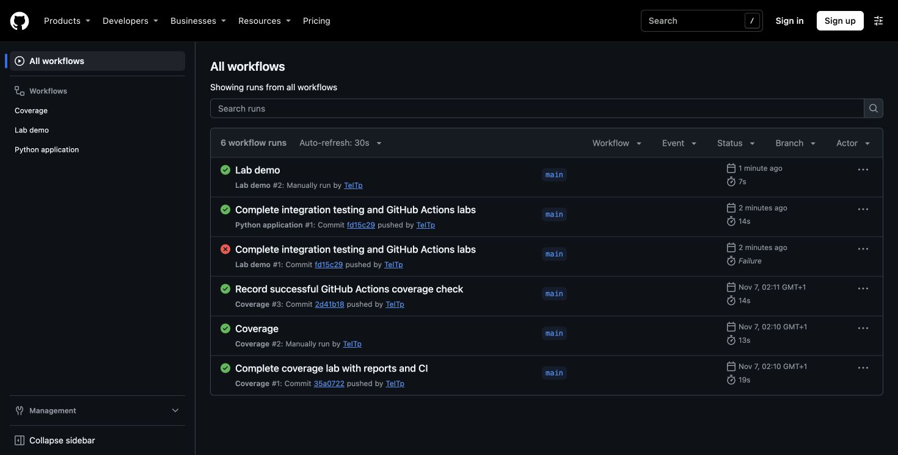
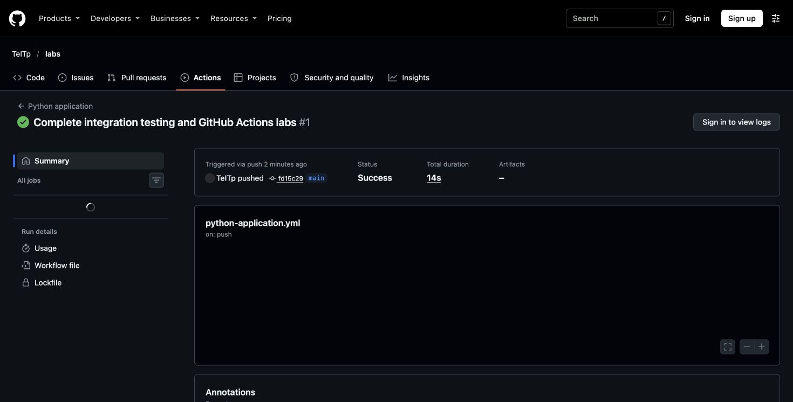
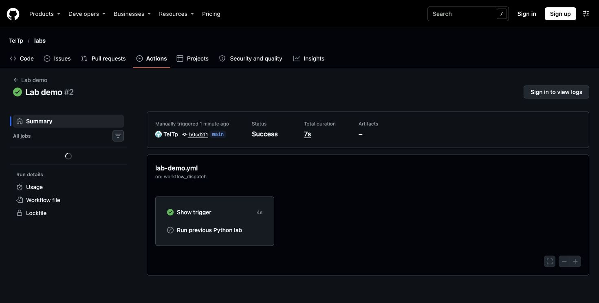

# Звіт до роботи 08

**Виконав:** Кушнір Андрій, КН-41

## Тема

Автоматизація перевірок Python за допомогою GitHub Actions.

## Мета роботи

Налаштувати автоматичну перевірку коду, ручний запуск із параметром, запуск за розкладом та умову виконання завдання.

## Виконання роботи

1. За основу взято [шаблон Python application](https://github.com/actions/starter-workflows/blob/main/ci/python-app.yml). Адаптований YAML додано через Git. [Файл Python application](../.github/workflows/python-application.yml)
2. Перше завдання отримує код, налаштовує Python 3.13, встановлює Flask, pytest і flake8, перевіряє код та запускає інтеграційні тести. Друге завдання запускає `python 08_github_actions/lab.py`. Скрипт використовує `Figure` і `print_info` з попередньої лабораторної. Результат локального запуску: `квадрат: довжина 5`. [Скрипт](lab.py)
3. У другому workflow додано `workflow_dispatch` з логічним параметром `run_demo` та `schedule` з cron `30 14 * * 3` (щосереди о 14:30 UTC). Завдання `trigger` завжди виводить тип події. Завдання `demo` виконується за розкладом або під час ручного запуску з `run_demo=true`. За ручного запуску з `run_demo=false` GitHub пропускає `demo`. [Файл Lab demo](../.github/workflows/lab-demo.yml)
4. У кореневий README додано два бейджі зі статусами. [Вкладка Actions](https://github.com/TeITp/labs/actions)

## Результати запусків

На вкладці Actions відображаються обидва нові workflow.

Після push обидва завдання **Python application** завершилися успішно. Flask integration tests виконав вісім тестів, а Run previous Python lab запустив код попередньої лабораторної. [Запуск Python application](https://github.com/TeITp/labs/actions/runs/45282268191)

Під час ручного запуску **Lab demo** з параметром `run_demo=false` завдання Show trigger завершилося успішно, а Run previous Python lab було пропущено. Розклад налаштовано, результат виконання за розкладом ще не зафіксовано. [Ручний запуск Lab demo](https://github.com/TeITp/labs/actions/runs/45282443914)

## Висновок

Налаштовано два workflow та декілька завдань. Перевірка Python запускається після змін у файлах лабораторної. Параметр ручного запуску керує виконанням демонстрації.
